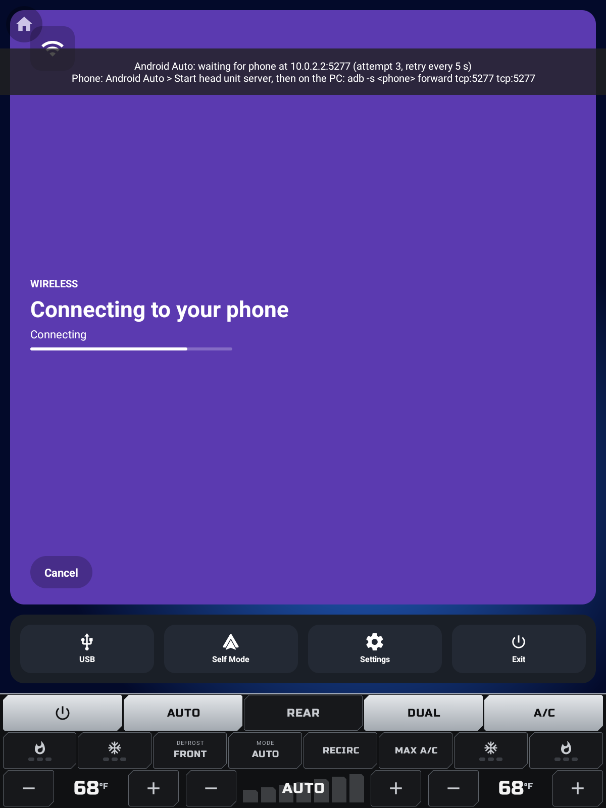
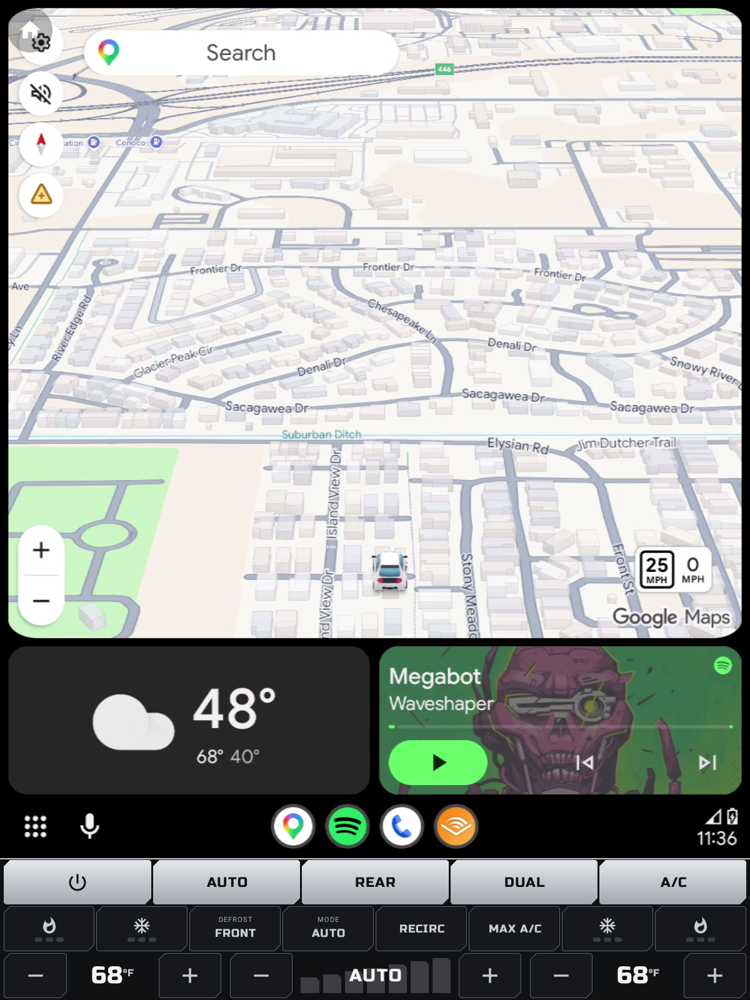

# Real Android Auto inside the emulator (TCP head unit server)

The emulator has no USB phone, so the receiver (our Open Headunit fork, `com.andrerinas.headunitrevived`) talks
to the Android Auto app on your phone over TCP, using Android Auto's developer **head unit server** on port
5277. The chain is:

    receiver in emulator --TCP--> 127.0.0.1:5277 --adb reverse--> PC 127.0.0.1:5277 --adb forward--> phone:5277 (head unit server)

Both hops are adb port mappings: `adb reverse` on the emulator (done by `install-all.sh`) and `adb forward` on
the phone (done per session, below). We deliberately do **not** use the emulator's NAT alias `10.0.2.2`: on
Windows/WHPX the guest-side connect timed out on every attempt even though the PC accepted it. On the real
head unit the transport is USB and none of this applies.

## One-time setup

### Phone

1. Update **Android Auto** from the Play Store (old versions lack or break the head unit server).
2. Open Android Auto settings: on Android 10+ that is *Settings > Connected devices > Connection preferences >
   Android Auto* (or search for "Android Auto" in Settings).
3. Scroll to the bottom and tap **Version** about 10 times until "Allow development settings?" appears; accept.
4. Enable **USB debugging**: *Settings > About phone*, tap *Build number* 7 times, then
   *Settings > System > Developer options > USB debugging* on. Then **unplug and replug** the cable: the
   phone only re-enumerates with the ADB interface on reconnect (until then Windows sees it as media-only,
   USB PID `4EE1`, and the "Allow USB debugging?" prompt never appears). Accept that prompt with
   "Always allow from this computer".

### PC / emulator

```bash
cd /c/Users/Stephen/Documents/projects/phoenix-android && source scripts/env.sh
bash scripts/build-receiver.sh                 # builds ../open-headunit (branch phoenix) -> build/receiver/
ANDROID_SERIAL=emulator-5554 bash scripts/install-all.sh   # installs everything incl. the receiver
```

In the launcher, *Settings > Android Auto transport* should show **TCP** with `127.0.0.1` / `5277`
(this is the default on the emulator; USB is the default on real hardware). `install-all.sh` also runs
`adb reverse tcp:5277 tcp:5277` on the emulator; after an emulator restart without reinstalling, run it again:

```bash
adb -s emulator-5554 reverse tcp:5277 tcp:5277
```

## Every session

1. Plug the phone into the PC by USB and accept the "Allow USB debugging?" prompt on the phone.
2. With **two** adb devices attached (phone and emulator), every adb command needs `-s`:

   ```bash
   adb devices                                   # e.g. emulator-5554 and R5CT1234ABC
   ```

3. On the phone: Android Auto settings > three-dot menu (top right) > **Start head unit server**.
   A notification "Head unit server running" appears. **Then leave the phone on that screen, unlocked,
   screen on.** Navigating around inside Android Auto's settings (e.g. "Connect a car") stops the server
   within seconds; the emulator then shows "reconnecting". The first-run prompts appear on their own.
4. Forward the port. The forward is created on the PC side for the **phone** serial:

   ```bash
   adb -s <phone-serial> forward tcp:5277 tcp:5277
   adb -s <phone-serial> forward --list          # should list: <phone-serial> tcp:5277 tcp:5277
   ```

5. Open the launcher's Android Auto pane and tap **Open Android Auto** (on a fresh launcher start it opens by
   itself once the audio path is ready). The receiver connects to `127.0.0.1:5277`, retrying 5 s after each
   failed attempt, and shows "Android Auto: waiting for phone at 127.0.0.1:5277 (attempt N ...)" until the phone answers.
   Accept any prompt on the phone; the projection then fills the screen above the 227 px climate bar.
6. The **HOME** key at the left end of the climate bar goes back to the launcher (system HOME). The receiver
   stops retrying while it is in the background; tap **Open Android Auto** to resume. (The receiver's own floating
   home button is suppressed by the launcher's `phoenix.home_button=false`; it only appears on manual launches
   that omit that extra.)

Manual launch without the launcher (same extras the launcher sends):

```bash
adb -s emulator-5554 shell am start -n com.andrerinas.headunitrevived/com.andrerinas.openheadunit.main.MainActivity \
  --es phoenix.transport tcp --es phoenix.host 127.0.0.1 --ei phoenix.port 5277 --ei phoenix.inset_bottom 227 \
  --ez phoenix.home_button false
```



First live session (Pixel 10 Pro XL over the TCP head unit server), with the climate bar over the projection:



The emulator decodes with `c2.goldfish.h264.decoder` (software) and manages only ~3-12 fps; that is an
emulator limitation, the head unit has a hardware decoder.

## Troubleshooting

| Symptom | Fix |
| --- | --- |
| Receiver keeps saying "waiting", logcat shows `ECONNREFUSED` | Nothing is listening on the PC's 5277: the forward is missing (`adb -s <phone> forward --list`) or the head unit server is not running on the phone. If the emulator-side `adb -s emulator-5554 reverse --list` is empty, re-run the reverse. |
| Receiver logs `SocketTimeoutException ... after 5000ms` | You are connecting to `10.0.2.2` (emulator NAT). Set the host to `127.0.0.1` and use `adb reverse` as above. |
| Connects, then drops after a few seconds | The phone's screen turned off or Android Auto was swiped away; the head unit server stops with it. Keep the phone unlocked and screen on (Developer options > *Stay awake* while charging). |
| "Start head unit server" missing from the menu | Developer settings not enabled (tap Version 10x again) or Android Auto is outdated. |
| `adb: more than one device/emulator` | Add `-s emulator-5554` or `-s <phone-serial>`, or `export ANDROID_SERIAL=...`. |
| Forward disappears | It is tied to the adb server and the phone's USB link: re-run it after replugging the phone or `adb kill-server`. |
| Port 5277 already in use on the PC | Something else holds it (a desktop head unit, an old forward): `adb forward --remove-all`, or forward another PC port (`adb -s <phone> forward tcp:5300 tcp:5277`) and set the launcher's port to 5300. |
| Black or stuttering video | The emulator uses MediaCodec only (no FFmpeg software decoder for x86_64). Use a host-GPU emulator (`-gpu host`); real hardware is unaffected. |
| Music/voice plays on the **phone**, not the emulator | The receiver classified the session as Self Mode (a 127.x peer) and did not announce its media/speech sinks; logcat shows "Self Mode ... media and speech audio channels are skipped". Fixed in fork commit `e974c9cd` (Phoenix TCP launches to loopback are remembered as a tunnel, not Self Mode); rebuild with `scripts/build-receiver.sh` and reinstall. |
| No sound | Expected until the launcher's audio path is READY: the receiver holds audio while it receives `AUDIO_PATH ready=false`. The header chip on the launcher shows the state. |
| Phone shows nothing / session never starts after the TCP connect | First connection to a new "car": unlock the phone and accept Android Auto's prompts (new car, permissions). If it still stalls, in Android Auto developer settings check *Unknown sources* is on, then stop and restart the head unit server. |
| Launcher pane says receiver not installed | `bash scripts/build-receiver.sh` then re-run `install-all.sh`, or check the receiver package in Settings. |

Useful logs: `adb -s emulator-5554 logcat | grep -E "OPENHU|Phoenix"`.
