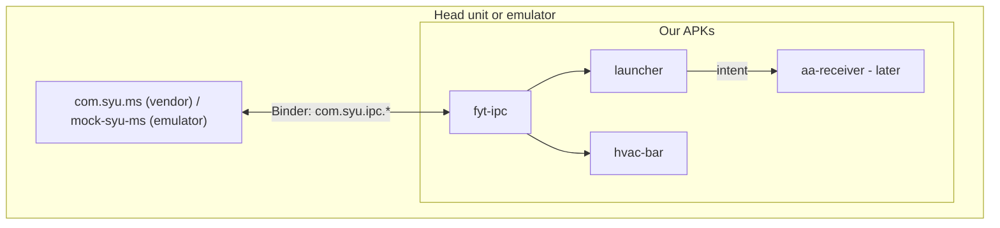
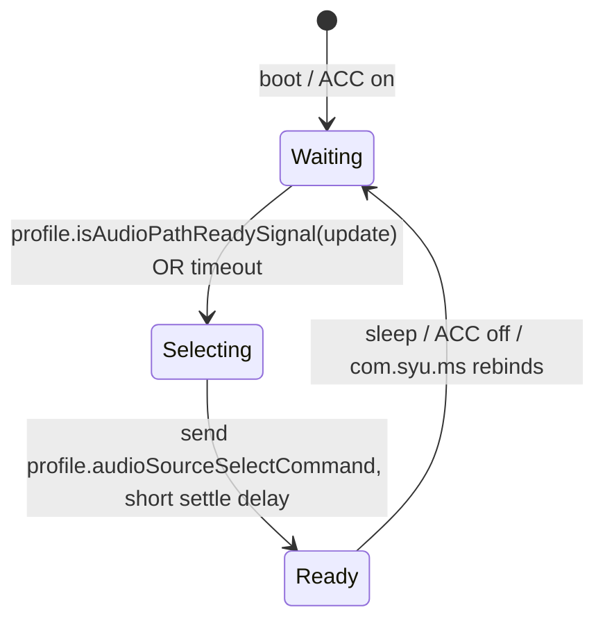

# Architecture

Custom user-space replacement for the stock FYT software on a Phoenix Automotive Tesla-style head unit
(UIS7862(s), genuine Android 12 / API 31, MCU `AYI_53_L6315_G23P48F64_E60`) in a 2011 Ford F-150 Raptor
with Sync 2. We do **not** replace the OS. We ship APKs that replace the launcher, the Android Auto
receiver and the climate bar, talking to the vendor's IPC service (`com.syu.ms`) like the stock apps do.

Full background and phased plan: the Cursor plan file `phoenix_f-150_head_unit_replacement`.

## Modules

| Module | Type | applicationId / namespace | Purpose |
| --- | --- | --- | --- |
| `fyt-ipc` | library | `com.phoenix.fytipc` | Binder client for `com.syu.ms` toolkit, MCU frame codec, climate model, vehicle profiles, JSONL capture format |
| `mock-syu-ms` | app | **`com.syu.ms`** | Emulator stand-in for the vendor service. Same package, action, descriptors and transaction ids. Simulates the F-150 climate system, the boot audio race, and replays captures |
| `launcher` | app | `com.phoenix.launcher` | HOME app. Boots into AA, switcher AA / Radio / Phone / Settings, audio-path readiness state machine, self-update |
| `hvac-bar` | app | `com.phoenix.hvacbar` | Omnipresent climate bar overlay replacing `com.syu.air` |
| (later) `aa-receiver` | app | fork of Open Headunit | Android Auto receiver. Not part of the emulator milestone |

Dependency direction: `mock-syu-ms`, `launcher`, `hvac-bar` -> `fyt-ipc`. Apps never depend on each other.



## The vendor IPC surface (what `fyt-ipc` wraps)

Bind `Intent("com.syu.ms.toolkit").setPackage("com.syu.ms")`. Three AIDL interfaces, hand-rolled (no .aidl
in the build; descriptors and transaction ids are in `SyuBinder`):

```
interface IRemoteToolkit  { IRemoteModule getRemoteModule(int moduleId); }                      // tx 1
interface IRemoteModule   { void cmd(int code, int[] i, float[] f, String[] s);                  // tx 1
                            ModuleObject get(int code, int[] i, float[] f, String[] s);          // tx 2
                            void register(IModuleCallback cb, int code, int flag);               // tx 3
                            void unregister(IModuleCallback cb, int code); }                     // tx 4
interface IModuleCallback { void update(int code, int[] i, float[] f, String[] s); }             // tx 1
```

Module ids: 0 MAIN, 1 RADIO, 2 BT, 4 SOUND, 7 CANBUS, 10 STEER (full table in `Modules`).
Facts verified by the community on live FYT hardware that our code relies on:

- No permission gate; an ordinary app can read and write.
- Registration notifies on change **and replays the cached value immediately**. `get()` returns nothing
  useful for climate codes. Registration is the only read path.
- Reads and writes use different code spaces: `U_AIR_*` ids are what you subscribe to; writes are
  `cmd(FIXED_CODE, int[]{ index, value })` with per-vehicle indices. Sending a read id to `cmd()` is
  silently discarded.
- CANBUS code 1019 streams raw MCU frames (`2E id len payload cksum`) as `int[]` of bytes; code 1008 sends.
- `com.syu.ms` force-stops ~27 third-party packages when the unit sleeps (ACC off). Our apps must
  tolerate being killed and come back on wake; the launcher, being HOME, is relaunched by the system.

## Vehicle profiles

Everything CAN-box specific sits behind `VehicleProfile` (`fyt-ipc/.../profile`). `FordF150Profile` is the
target and currently mirrors `Wk2ReferenceProfile` (the only published, verified table) until values are
recorded in the truck. `mock-syu-ms` drives its simulation from the same profile, so when the profile is
corrected the emulator follows automatically.

## Captures

`FrameLogEntry` (JSONL) is the single interchange format between the truck recorder and the emulator
replayer. Committed captures live in `docs/captures/`. Each `up` line is a `ModuleUpdate`, each `cmd` line
is a `ModuleCommand` we sent, `mark` lines are human annotations ("tapped Radio in stock UI").

## The boot audio race

Phoenix retains the OEM ACM (radio brain) and factory amp; head-unit audio enters via the ACM AUX input and
the CAN box must (a) wake/select that source and (b) assert amp-on. Today AA produces audio before that
happens, so nothing is heard until the user taps "Radio" in the stock UI (which sends a source command).

Launcher owns an **audio-path readiness state machine** (foreground service):



While not `Ready`, the launcher asks the AA receiver to hold audio (broadcast
`com.phoenix.launcher.action.AUDIO_PATH` with `ready=false|true`; the AA fork will honour it later). The mock
simulates the race: the readiness signal arrives N seconds after "boot", and audio is only "audible" after the
source-select command has been received. The mock exposes that as a debug code so the launcher can show it.

## Emulator

AVD `phoenix_f150`: Android 12 (API 31) x86_64 google_apis, 1200x1600 @160dpi portrait (FYT convention
dp = px; confirm with `adb shell wm size` on the real unit). Scripts: `scripts/create-avd.sh`,
`scripts/run-emulator.sh`, `scripts/install-all.sh`. Toolchain is user-scope under
`C:\Users\Stephen\android-tools` (see `scripts/env.sh`).

Emulator milestone = `install-all.sh` on a fresh AVD gives: mock running, our launcher as HOME booting into the
AA pane (placeholder when no receiver installed), switcher working, HVAC bar overlay reflecting and driving the
mock climate state, audio-readiness state visibly progressing Waiting -> Selecting -> Ready.

## Conventions

- Kotlin, Jetpack Compose, Material 3, coroutines/Flow. `minSdk 31`, `targetSdk 33`, `compileSdk 34`.
- No root, no `android.uid.system`, no platform-key assumptions.
- Public API of `fyt-ipc` (`FytToolkit`, `FytModule`, `ModuleUpdate`, `ModuleCommand`, `VehicleProfile`,
  `ClimateState`, `ClimateAction`, `McuFrame`, `FrameLogEntry`) is the contract between modules; change it
  only with a matching change in every consumer.
- Unit tests under `src/test` (JUnit4 + Truth; Robolectric where Android types are needed). Keep them fast.
- Everything that is a guess about the F-150 CAN box is marked `UNVERIFIED` in code comments.
